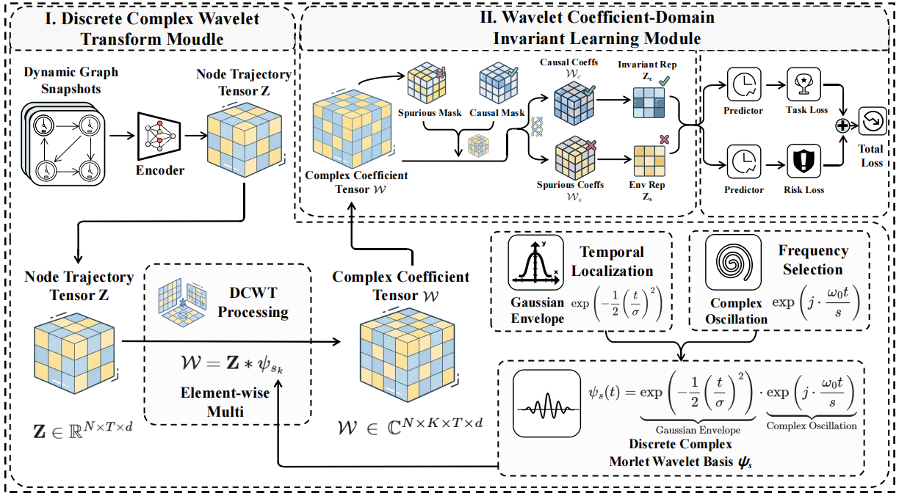

# 🚀 **WavCIL: Wavelet Coefficient-Domain Invariant Learning for Dynamic Graph Out-of-Distribution Generalization**

This repository provides the official implementation of the paper:" WavCIL: Wavelet Coefficient-Domain Invariant Learning for Dynamic Graph Out-of-Distribution Generalization".

---

📖 Overview

DyGNNs have demonstrated strong representation capabilities in time-series systems such as financial transaction risk forecasting and social network analysis. However, real-world dynamic graphs are often influenced by complex time-varying factors like emergency incidents, leading to unpredictable distribution shifts that severely degrade model performance due to insufficient out-of-distribution (OOD) generalization. Existing graph invariant learning has been extensively studied to improve OOD generalization by leveraging data from diverse distributions to disentangle:

🔗 Causal patterns: Stable across time and invariant to time-varying factors.

⚠️ Spurious patterns: Driven by time-varying factors and sensitive to distribution shifts.

WavCIL addresses this challenge by conducting invariant learning within a wavelet coefficient domain endowed with time-frequency localization. The framework consists of two key modules:

🔄 Wavelet Transform Module: Leverages the Discrete Complex Morlet Wavelet Transform to map node temporal trajectories into a multi-scale coefficient domain, simultaneously capturing frequency components and preserving their temporal localization.

🎯 Coefficient-Domain Invariant Learning Module: Employs an adaptive dual mask mechanism to disentangle stable causal patterns from spurious patterns, and optimizes an intervention-based variance penalty to enforce predictions that rely more on the causal patterns.

---


## 🏗️ **Framework**



 ✨ **Features**

- ✅**Time-Frequency Localization**: Introduces ` the Discrete Complex Wavelet Transform` to preserve both temporal locality and frequency information for dynamic graph representation learning.

- ✅**Wavelet Coefficient-Domain Invariant Learning**: WavCIL utilizes an adaptive mask mechanism to disentangle stable causal patterns invariant to time-varying factors from spurious patterns driven by time-varying factors in the coefficient domain, guiding the prediction process to rely more on the causal patterns.

- ✅**Two Core Tasks**: Supports both dynamic `Link Prediction (LP)` and dynamic `Node Classification (NC)` under temporal distribution shifts.

- ✅**Real and Synthetic Dynamic Graph Datasets**: Includes experiments on `Wiki`, `Flight`, `Reddit`, `MOOC`, `Aminer`, `OGBN-Arxiv`, and `synthetic datasets` with controllable shift intensity.

---

## 📁 **Project Structure**

```text
WavCIL-main/                     # Project root directory
|- DIDA/                         # Baseline
|- scripts/                      # Main WavCIL experiment code and entry scripts
|  |- WavCIL_NC_E/               # Node classification experiments
|  |  |- aminer/                 # Aminer node classification scripts
|  |  |- arxiv/                  # OGBN-Arxiv node classification scripts
|  |  `- syn_SBM_wav/            # Synthetic node classification scripts
|  `- WavCIL_LP_E/               # Link prediction experiments
|     |- dida_data_wav/          # Synthetic link prediction scripts
|     `- wavcil_lp_unified/      # Unified link prediction scripts for flight/mooc/reddit/wiki
|        |- config.py            # Experiment configuration
|        |- dcwt_experiment.py   # Unified WavCIL experiment launcher with dataset profiles
|        |- main.py              # Main training entry for loading data, training, and saving logs
|        |- model.py             # WavCIL model definition 
|        |- parallel-rep.py      # Parallel batch experiment runner for repeated trials
|        |- utils.py             # Utility functions, predictors and training helpers
|        `- wavcil_backbone.py   # Temporal graph backbone modules for the unified WavCIL LP setup
|- sild/                         # Shared utility modules
|- setup.py
`- README.md
```

---

## 📚 **Dataset Sources**

The datasets used in this repository are collected from the following sources:

- [Temporal Graph Benchmark (TGB)](https://tgb.complexdatalab.com/docs/linkprop/), which provides dynamic link prediction benchmarks such as `tgbl-wiki` and `tgbl-flight`.
- [Open Graph Benchmark (OGB)](https://ogb.stanford.edu/docs/nodeprop/#ogbn-arxiv), which provides the `ogbn-arxiv` node classification benchmark.
- [Zenodo: Towards Better Evaluation for Dynamic Link Prediction](https://zenodo.org/records/7008205), which releases temporal graph datasets and preprocessing-ready files widely used in dynamic link prediction evaluation.

---

## 📈 **Results**

| Dataset  |         Task        | Data Type  | Metric | DyGFormer | GraphMixer | TGN | DEFT-T | IRM | VREx | GroupDRO | STONE | DIDA | SILD | EAGLE | WavCIL (ours) |
|----------|---------------------|------------|--------|-----------|------------|-----|--------|-----|------|----------|-------|------|------|-------|----------------|
|   Wiki   |   Link Prediction   | Real-world |  AUC   | 83.16±0.39 | 64.78±1.15 |75.50±0.93  | 54.01±1.26 | 82.98±0.14 | 83.34±0.09 | 84.17±0.36 | 84.80±0.23 | 84.94±0.12 | 80.02±0.60 | 81.87±0.13 | 85.76±0.64 |
|Synthetic-0.4|   Link Prediction   | Synthetic  |  AUC   | 86.94±0.27 | 83.34±0.56 | 85.08±0.61 | 73.25±3.47 | 56.83±0.21 | 76.61±1.71 | 75.67±1.59 | 71.77±0.15 | 85.20±0.84 | 85.96±0.19 | 88.32±0.61 | 90.87±0.33 |
|OGBN-Arxiv| Node Classification | Real-world |  ACC   | 26.90±0.34 | 26.39±0.13 | 12.54±1.29 | 14.99±0.07 | 51.00±0.52 | 52.60±0.45 | 55.25±0.09 | 50.00±1.52 | 50.41±0.45 | 53.36±3.65 | 57.90±4.25 | 58.53±0.68 |
|Synthetic-0.4| Node Classification | Synthetic  |  ACC   | 22.55±0.01 | 22.62±0.18 | 24.96±0.99 | 43.33±2.11 | 33.23±4.70 | 41.78±1.30 | 41.35±2.19 | 24.89±1.59 | 43.33±7.74 | 43.82±3.97 | 26.92±0.31 | 43.89±0.36 |


---

## 🛠️ **Usage**
Set up the environment as follows:

```bash
pip install torch==2.0.1
pip install torch_geometric==2.3
pip install pyg_lib torch_scatter torch_sparse torch_cluster torch_spline_conv -f https://data.pyg.org/whl/torch-2.0.0+cu117.html

pip install -e .
pip install -e ./DIDA
```

An example to run the model is given as follows:

```bash
cd scripts/WavCIL_LP_E/wavcil_lp_unified
python dcwt_experiment.py -t run
```

A customized run with explicit paramters is shown below:
```bash
python main.py --dataset wiki --backbone wavcil --spec_filt dcwt --device_id 0 --seed 0 --dcwt_scales 8 --dcwt_omega0 6.9 --intervene_lambda 1e-4 --intervene_times 100 --post_temporal 1 --heads 2 --norm 1 --temporature 0.45 --dropout 0.35 --nfeat 64 --min_epoch 200 --log_dir ../../../logs/main_test_wiki
```

**Main paramters**
- `--dataset`: dataset name, e.g. `wiki`, `reddit`, `flight`, `synthetic-0.4`
- `--backbone`: backbone model, e.g. `wavcil`, `GCN`, `GIN`, `GAT`
- `--device_id`: GPU device id, e.g. `0`, `1`
- `--log_dir`: path to save experiment logs
- `--dcwt_scales`: number of DCWT scales
- `--dcwt_omega0`: central frequency for DCWT
- `--intervene_lambda`: intervention loss weight, e.g. `1e-4`
- `--seed`: random seed, e.g. `0`, `1`, `2`

To show the results:

```bash
python dcwt_experiment.py -t show
```

## 📊 **Supported Tasks and Datasets**

**Link Prediction**

- `Wiki`
- `Flight`
- `Reddit`
- `MOOC`
- `Synthetic-LP (0.4 / 0.6 / 0.8)`

**Node Classification**

- `Aminer`
- `OGBN-Arxiv`
- `Synthetic-NC (0.4 / 0.6 / 0.8)`

---

## 🙏 **Acknowledgments**

We thank the authors of related dynamic graph benchmarks and baseline methods for making their datasets and code publicly available.
- [SILD](https://github.com/wondergo2017/sild)
- [DIDA](https://github.com/wondergo2017/DIDA)
- [DyGFormer](https://github.com/yule-BUAA/DyGLib)
- [TGN](https://github.com/twitter-research/tgn)
- [GraphMixer](https://github.com/CongWeilin/GraphMixer)
- [EAGLE](https://github.com/RingBDStack/EAGLE)
- [DEFT-T](https://github.com/ansonb/DEFT)
- [STONE](https://github.com/PoorOtterBob/STONE-KDD-2024)
- [IRM](https://github.com/facebookresearch/InvariantRiskMinimization)
- [vREx](https://github.com/capybaralet/REx_code_release)
- [GroupDRO](https://github.com/kohpangwei/group_DRO)
- [DyCIL](https://github.com/xxzhang99/DyCIL)
- [EvoGOOD](https://github.com/RingBDStack/EvoGOOD)
- [DyAug](https://github.com/bingreeky/DyAug)
- [EQuAD](https://github.com/tianyao-aka/EQuAD)
- [FreeDyG](https://github.com/Tianxzzz/FreeDyG)

---


